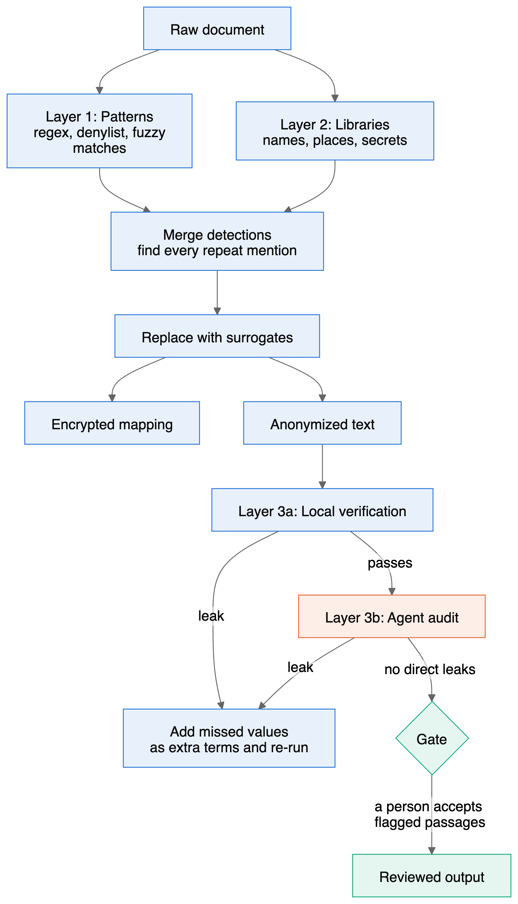
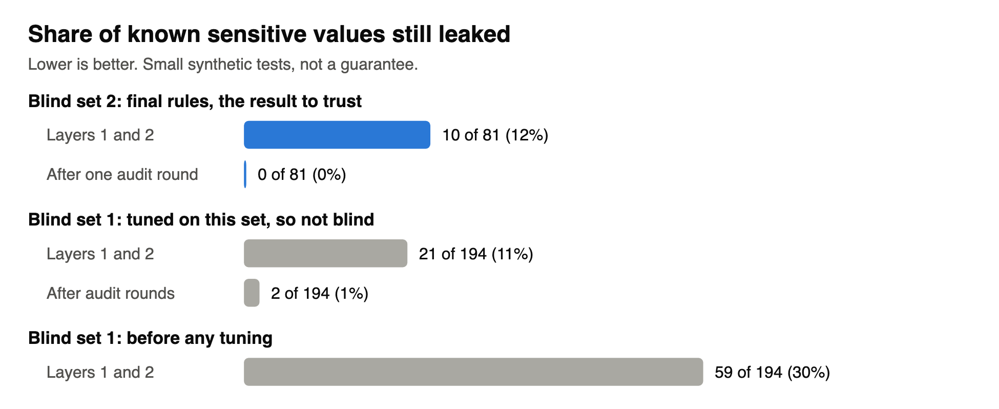
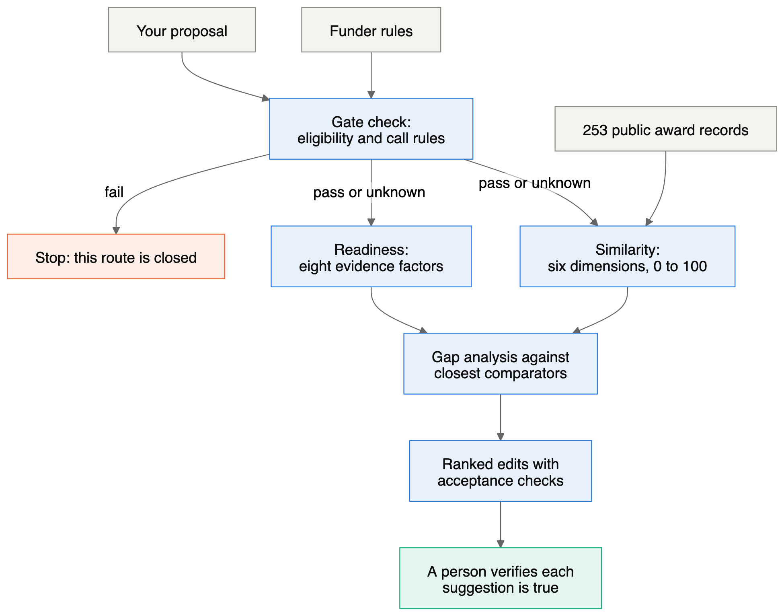

# Privacy and Grant Tools for Civil Society

Two tools for organizations working on human rights, independent media and democracy:

1. **Multilayer PII anonymizer.** Replaces names, contacts, IDs and credentials in long documents with realistic stand-ins that can be restored later.
2. **Grant proposal critic.** Compares a proposal with publicly documented funded projects, then ranks concrete revisions by priority.

Built at the HRF 2026 Hack and Tell. Both are working prototypes, tested on synthetic documents. Neither replaces a human reviewer, and neither makes a legal or funding guarantee.

**Full manual: [Markdown](docs/MANUAL.md) | [PDF](docs/MANUAL.pdf) | [Word](docs/MANUAL.docx)**

## At a glance

| | Anonymizer | Grant critic |
|---|---|---|
| **Input** | UTF-8 text or Markdown | A proposal, plus a list of funders |
| **Output** | Anonymized text, encrypted mapping, leak report | Scoring rubric, ranked comparable projects, ranked edits |
| **Form** | Command-line tool and Claude Code skills | Agent research prompt, saved evidence and Python report scripts |
| **Location** | [`anon-artifacts/`](anon-artifacts/) | [`revisions/`](revisions/), [`dev/prompt_grant-proposal-diff-critiques.md`](dev/prompt_grant-proposal-diff-critiques.md) |
| **Checks** | 215 automated tests | 785 consistency assertions on the research outputs |

## Multilayer PII anonymizer

Each layer catches what the previous one misses:

| Layer | What it does | Runs |
|---|---|---|
| 1. Patterns | Regular expressions with checksums, your own denylist, fuzzy spelling matches, spoken numbers and emails | Locally |
| 2. Libraries | Presidio with spaCy for names and places; detect-secrets, gitleaks and credential rules for keys and passwords | Locally |
| 3a. Verification | Searches the output for every original value and re-runs the detectors | Locally |
| 3b. Agent audit | A fresh AI agent reads only the anonymized text, hunts for leaks and flags sentences that could identify someone without naming them | By default through Claude Code, so this text reaches the model provider |

Each layer, threshold and entity type is configurable in [`engine/config.yaml`](anon-artifacts/engine/config.yaml).



*Blue steps run on your machine. The orange step reaches the model provider under the default setup. Green steps involve a person.*

### Quick start

```bash
cd anon-artifacts/engine && uv sync && cd ..
bin/anon init-key
cp terms.local.yaml.example terms.local.yaml    # add your organization's own names
```

Save a document to `anon-artifacts/workspace/raw/`, start Claude Code inside `anon-artifacts/`, then run:

```text
/anonymize workspace/raw/notes.md
```

Do not paste sensitive text into the chat, because it reaches the model provider immediately. See the [shell workflow](docs/MANUAL.md#25-shell-workflow) for use without an agent.

### Measured results

From a blind test: 4 synthetic documents written without sight of the code, holding 81 known sensitive values.

| Measure | Result |
|---|---|
| Values leaked after layers 1 and 2 | 10 of 81 |
| Values leaked after one audit round | 0 of 81 |
| Words that should stay but were replaced | 15 of 26 |



This is a small test and probably optimistic, because the same model family wrote and audited the documents. The output is pseudonymized, not anonymous, and a person must read flagged passages before it is shared. Read the [limits](docs/MANUAL.md#29-limits).

## Grant proposal critic

Given a proposal and a set of funders, the method produces:

1. A **gate check** for eligibility, which similarity scoring can never override.
2. A **similarity ranking** against public funded-project records, with score bounds where records are sparse.
3. A **readiness rubric** that shows what evidence the proposal still lacks.
4. A **ranked list of edits**, each with a priority calculation and an acceptance check.



The saved evidence covers **15 funders and 253 public award records**, from the Open Technology Fund to the National Endowment for Democracy.

### Example result

A [fictional proposal](dev/fictional_NED_proposal_russian-ngo.md) to the National Endowment for Democracy produced [this report](revisions/version_20261104-1652/DIFF_REPORT.md). Its top three edits:

| Priority | Edit |
|---|---|
| 10.12 | Demonstrate realistic, safe delivery |
| 7.12 | Fix monitoring definitions and targets |
| 6.38 | Strengthen evidence of demand and track record |

**These scores are editorial priorities, not funding probabilities.** The evidence contains only funded projects, so it cannot show why a project won. See [how to read the results](docs/MANUAL.md#35-how-to-read-the-results).

To evaluate your own proposal, follow [running a new evaluation](docs/MANUAL.md#37-running-a-new-evaluation). This is an agent-assisted process, not yet a one-command tool.

## Repository layout

```text
anon-artifacts/   Anonymizer: engine, CLI, skills, tests, spec and report
revisions/        Grant critic: dated evidence, rubric, rankings and reports
dev/              Source prompts, funder list and the sample proposal
docs/             Manual and session handoffs
transcripts/      Session exports
```

## Requirements

- **Anonymizer:** Python 3.12, [uv](https://docs.astral.sh/uv/) and about 600 MB of disk. gitleaks is optional. The default audit needs [Claude Code](https://claude.com/claude-code).
- **Grant critic:** Python 3 standard library to rebuild reports, and a research-capable AI agent for new evaluations.

## License

[Apache License 2.0](LICENSE).
