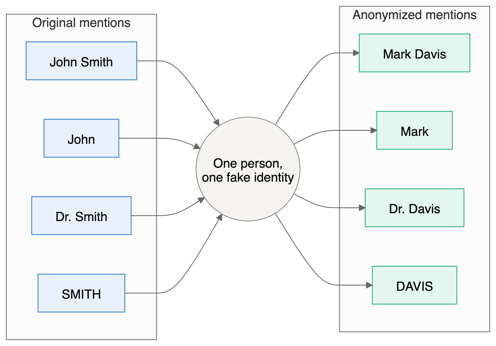
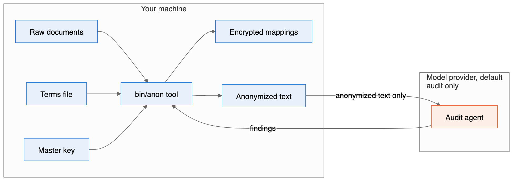
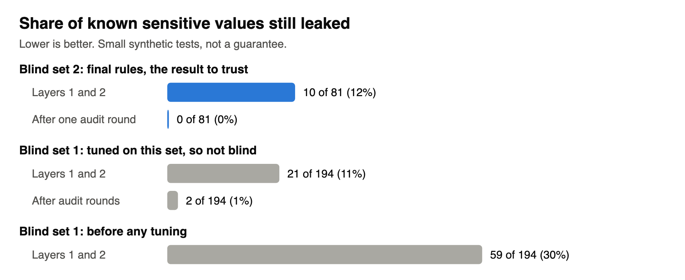
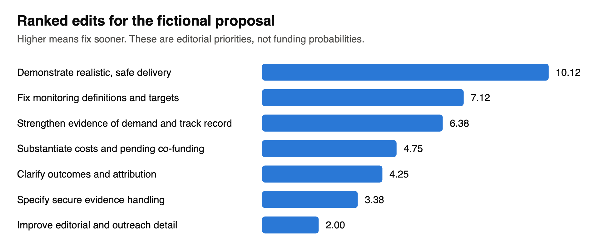

# User Manual

This manual covers both tools in this repository: the multilayer PII anonymizer and the grant proposal critic. For a short overview, see the [README](../README.md). This manual is available as [Markdown](MANUAL.md), [PDF](MANUAL.pdf) and [Word](MANUAL.docx).

**Contents**

- [Part 1: Before you start](#part-1-before-you-start)
- [Part 2: Multilayer PII anonymizer](#part-2-multilayer-pii-anonymizer)
- [Part 3: Grant proposal critic](#part-3-grant-proposal-critic)
- [Part 4: Using the tools together](#part-4-using-the-tools-together)
- [Part 5: Troubleshooting](#part-5-troubleshooting)
- [Appendix: rebuilding this manual](#appendix-rebuilding-this-manual)

---

# Part 1: Before you start

## 1.1 Who this is for

These tools are for staff at civil-society organizations and the technologists who support them. You need to be comfortable running commands in a terminal. Part 2 does not require programming. Running a new grant evaluation (section 3.7) does involve directing an AI agent and editing a script.

## 1.2 Status

Both tools are prototypes built at a hackathon.

| Status | Anonymizer | Grant critic |
|---|---|---|
| **Tested** | Command-line flow, 215 automated tests, and real audit agents on synthetic documents | Arithmetic and record consistency, through 785 assertions |
| **Not tested** | Real documents, non-English text, live Anthropic and Ollama backends, optional GLiNER2 and OpenAI Privacy Filter models, and the full `/anonymize` skill in a live session | Accuracy of every source claim, current funder rules, and any effect on funding outcomes |

## 1.3 Three rules for sensitive work

1. **Anything an AI agent reads reaches its provider.** Never paste sensitive text into a chat, and never ask an agent to open a raw file.
2. **Automated output is not safe by itself.** A person who understands the risks must read the result before it is shared.
3. **Replacing names does not hide everyone.** "The only woman judge in the northern district" identifies a person without naming her.

---

# Part 2: Multilayer PII anonymizer

## 2.1 What it does

The tool replaces sensitive values with realistic substitutes, called **surrogates**. A sentence stays readable:

> **Original:** Ana Costa met Dr. Reyes at 27 Harbour Street. Email ana@example-org.test.
>
> **Anonymized (illustrative):** Laura Burch met Dr. Marshall at 382 Amy Crest. Email laura.burch@example.net.

The same person gets the same surrogate everywhere, so the narrative still makes sense. The mapping back to the originals is encrypted and stored separately, so an authorized person can restore the document later.

**This is pseudonymization, not anonymization.** While the mapping exists, the data can be reversed. Under laws such as the GDPR, pseudonymized data generally remains personal data. Take legal advice for your situation.

## 2.2 How the layers work


*Figure 1. The anonymizer pipeline. Blue steps run on your machine. The orange step reaches the model provider under the default setup. Green steps involve a person.*

| Layer | Finds | Typical misses |
|---|---|---|
| **1. Patterns** | Emails, URLs, IP addresses, phone numbers, dates, ages, card numbers, IBANs, account numbers, ID numbers, addresses, handles, your denylist, misspellings of your denylist, spoken numbers and spoken emails | Names outside your denylist |
| **2. Libraries** | People, organizations and places (spaCy through Presidio); API keys, tokens, passwords and private keys | Uncommon names, nicknames and lowercase text |
| **3a. Verification** | Any original value that survived, including case and spacing variants | Anything never detected in layers 1 and 2 |
| **3b. Agent audit** | Remaining names and IDs, plus combinations of details that could identify someone | Anything that looks ordinary, such as your own organization's name |

Three design choices matter most:

- **Detection runs once, on the original text.** Surrogates are never re-scanned as input, which prevents double replacement.
- **Repeat mentions are propagated.** Once `Amina Yusuf` is found, later mentions of `Amina`, `Yusuf` and `amina` are replaced too. Ordinary English words are matched only when capitalized. Figure 2 shows how one person keeps one identity.
- **The audit agent sees only anonymized text.** It runs only after local verification passes, and it receives the list of surrogates so it does not flag them as leaks.



*Figure 2. Every form of a name maps to the same fake identity, so the narrative stays coherent. Example values only.*

## 2.3 Installation

```bash
cd anon-artifacts/engine
uv sync
cd ..
bin/anon init-key
```

`uv sync` installs Python packages and the spaCy language model into `engine/.venv`, which takes about 600 MB. `init-key` creates your key at `~/.config/anon3pass/master.key`.

> **Back up the key securely.** Without it, you cannot restore any document. Anyone holding both the key and a mapping file can reverse the anonymization. Keep the key away from the documents.

Optional features:

| Feature | Install | Status |
|---|---|---|
| gitleaks secret scanning | Install the `gitleaks` binary; it is used automatically | Tested |
| Anthropic API audit backend | `uv sync --extra anthropic` | Tested with fakes only |
| GLiNER2 name detection | `uv sync --extra gliner2` | Never run |
| OpenAI Privacy Filter | Install `opf` from [its repository](https://github.com/openai/privacy-filter) | Never run; command flags unconfirmed |

## 2.4 Your own terms file

This is the most reliable improvement you can make. Automated layers repeatedly missed organization names and acronyms in testing.

```bash
cp terms.local.yaml.example terms.local.yaml
```

```yaml
deny:
  - {term: "Lantern Aid", entity: ORGANIZATION}
  - {term: "Amina Yusuf", entity: PERSON}
allow:
  - Geneva
```

- `deny` terms are always replaced, along with close misspellings of terms at least 5 characters long.
- `allow` terms are never replaced, unless also listed under `deny`.

The file holds real names, so it is excluded from git. Do not share it. The guard hook stops agents from reading it.

## 2.5 Shell workflow

Run these from `anon-artifacts/`. This route does not use an agent until the audit step.

**Step 1: anonymize.**

```bash
bin/anon run workspace/raw/notes.md -o workspace/out
```

**Step 2: verify locally.** This exits with code 3 if a leak is found.

```bash
bin/anon verify workspace/out/notes.anon.md --map workspace/out/notes.map.enc
```

**Step 3: audit.** Build a packet, then run the backend set in `config.yaml`. With the default `claude_code` backend, `qa-run` only reports that an agent must be dispatched, so use the skill in section 2.6 for this step. Set `anthropic` or `ollama` to run it from the shell.

```bash
bin/anon qa-packet workspace/out/notes.anon.md -o workspace/out/notes.qa_packet.json
bin/anon qa-run workspace/out/notes.qa_packet.json -o workspace/out/notes.findings.json
```

**Step 4: feed findings back and re-run.** Then repeat steps 2 and 3 for a fresh audit.

```bash
bin/anon qa-apply workspace/out/notes.findings.json --map workspace/out/notes.map.enc -o workspace/out/notes.extra_terms.yaml
bin/anon run workspace/raw/notes.md -o workspace/out --extra-terms workspace/out/notes.extra_terms.yaml
```

**Step 5: pass the gate.**

```bash
bin/anon gate workspace/out/notes.report.json --findings workspace/out/notes.findings.json
```

The gate fails on any high-severity finding, and on any passage needing human judgment. After a person has read those passages and accepts them, they re-run with `--human-reviewed`. To change a passage, edit the source document and re-run.


*Figure 3. How the gate decides.*

**Step 6: restore when authorized.**

```bash
bin/anon restore workspace/out/notes.anon.md --map workspace/out/notes.map.enc -o restored.md
```

Restored files contain real data. Store them accordingly.

## 2.6 Claude Code workflow

Start Claude Code **inside `anon-artifacts/`**. The skills, agent and guard hook load only from there.

| Command | Purpose |
|---|---|
| `/anonymize workspace/raw/notes.md` | Run the full flow and report counts only |
| `/anon-qa` | Run or repeat the audit on an anonymized document |
| `/anon-restore` | Restore a document; the restored text is not shown in the chat |

The guard hook blocks agent access to `workspace/raw/`, mapping files, keys and `terms.local.yaml`. It is a safety net, not a sandbox: it inspects paths and commands, and a determined workaround could get past it. The skills tell agents never to add `--human-reviewed` on their own, but the hook does not enforce this, so check how the gate was run. That decision is yours.

**Note on the default audit:** the agent's text goes to Anthropic through Claude Code. Layers 1 and 2 left about one known value in eight in blind testing, so real values can reach the provider during the audit. For high-risk documents, see section 2.10.



*Figure 4. What leaves your machine under the default audit. Only anonymized text crosses, but it can still contain values the earlier layers missed. Setting the backend to `none` removes this crossing.*

## 2.7 Commands and files

| Command | Purpose | Exit codes |
|---|---|---|
| `anon init-key` | Create the master key | 0 |
| `anon run <files or dirs> -o <dir> [--extra-terms <file>]` | Anonymize `.txt` and `.md` files | 0, 4 |
| `anon verify <anon> --map <map>` | Local leak check | 0, 3 |
| `anon qa-packet <anon> -o <packet>` | Build an audit packet; refuses without a passing `verify` | 0, 3 |
| `anon qa-run <packet> -o <findings>` | Run the audit backend | 0 |
| `anon qa-apply <findings> --map <map> -o <terms>` | Turn findings into extra terms | 0 |
| `anon gate <report> --findings <findings> [--human-reviewed]` | Pass or fail the document | 0, 3 |
| `anon restore <anon> --map <map> -o <out>` | Restore the original values | 0 |

Exit codes: 0 success, 1 other error such as a tampered vault, 2 usage error, 3 leak or gate failure, 4 missing key or dependency. All commands accept `--config <file>` and `--json` before the command name.

| Output in `workspace/out/` | Contents | Safe to share? |
|---|---|---|
| `<doc>.anon.<ext>` | Anonymized text | Only after review |
| `<doc>.map.enc` | Encrypted mapping for one document | No |
| `_registry.registry.enc` | Encrypted surrogates shared across a folder | No |
| `<doc>.report.json` | Counts, hashes and status, with no originals | Yes |
| `<doc>.qa_packet.json` | Anonymized text for the auditor | Treat like the anonymized text |
| `<doc>.findings.json` | Audit findings, quoting anonymized text | Treat like the anonymized text |
| `<doc>.extra_terms.yaml` | Leaked values found by the audit | **No, it can hold real names** |

## 2.8 Configuration

All settings are in [`engine/config.yaml`](../anon-artifacts/engine/config.yaml). To keep the default intact, copy it and pass `--config my.yaml`; your file is merged over the defaults.

| Setting | Default | What it controls |
|---|---|---|
| `pipeline.passes` | `[patterns, libraries, agent_qa]` | Which layers run. Remove an entry to disable it |
| `pipeline.max_qa_iterations` | `2` | Audit and re-run cycles in the skill |
| `pipeline.fail_on` | `high` | Lowest severity that fails the gate |
| `pipeline.propagate_mentions` | `true` | Replace every later mention of a detected name |
| `pipeline.keep_public_entities` | UN bodies, major platforms and others | Names to leave unchanged |
| `pass1_patterns.enabled_rules` | All rules | Which pattern rules run |
| `pass1_patterns.custom_rules` | none | Your own regexes: `{name, regex, entity}` |
| `pass1_patterns.fuzzy.threshold` | `88` | Spelling match strictness, from 0 to 100 |
| `pass2_libraries.ner.engine` | `presidio_spacy` | Also `gliner2`, `opf` or `none` |
| `pass2_libraries.ner.score_threshold` | `0.45` | Minimum confidence for a detected name |
| `pass2_libraries.secrets.gitleaks` | `auto` | Use gitleaks when installed |
| `pass3_agent_qa.backend` | `claude_code` | Also `anthropic`, `ollama` or `none` |
| `surrogates.date_shift_days_max` | `180` | Range of the keyed date shift |
| `entity_policy.<TYPE>` | See file | `surrogate`, `generalize`, `redact` or `keep` |
| `secrets_policy.store_in_vault` | `false` | If true, secrets become restorable. Not recommended |

**Reducing over-redaction.** Add public bodies your readers need to `keep_public_entities`. To keep all organizations, set `entity_policy.ORGANIZATION: keep`, and list your sensitive ones under `deny`.

**How each value type is replaced:**

| Type | Treatment |
|---|---|
| People | Consistent fake names. Parts stay coherent, so `John Smith` and `Smith` share a surname. Gender is not inferred from names |
| Emails, URLs, IPs | Reserved example domains and documentation address ranges |
| Phone numbers | Format kept. US numbers use the reserved 555-01XX range. **Other countries' numbers could match a real one** |
| Dates | Shifted by one keyed offset, keeping intervals. Unparseable forms become `[DATE_1]` |
| Ages | Generalized, as in `34 years old` becoming `in their 30s` |
| API keys, passwords, tokens | Replaced with `[API_KEY_1]` style placeholders and **not restorable by default** |

## 2.9 Limits

- **Results are from small synthetic tests.** See section 2.11.
- **Identifying details are flagged, not rewritten.** Only a person can judge these passages.
- **Writing style can identify an author.** This tool does not address stylometry.
- **One known date reveals the others.** All dates under one key shift by the same number of days.
- **English first.** The language model is English, so other languages rely on patterns and the audit.
- **Text only.** Convert PDF and Word files first, and remember that metadata in the original file is not handled.
- **Over-redaction is high.** Expect public bodies and cities to be replaced until you tune the keep list.
- **No formal guarantee.** There is no k-anonymity score or differential privacy guarantee for narrative text.
- **Not a defense against a state adversary with outside data.** The tool reduces exposure, but it does not defeat that level of investigation.

## 2.10 Choosing a setup by risk

| Situation | Suggested setup |
|---|---|
| Routine reports and status updates | Default configuration with a reviewer reading the output |
| Partner names or internal details | Default, with a full terms file and a careful read of flagged passages |
| People at risk, witnesses or sources | Set `backend: none` so no text leaves your machine, and have a trained person review every line. Consider not sharing the document at all |

A local Ollama audit is built for the last case, but it has not been tested live.

## 2.11 Test results

All documents are synthetic. Each ran alone, with no denylist. A leak means a known value still appears as a whole word.

| Test | Known values | After layers 1 and 2 | After audit | Keep-words replaced |
|---|---|---|---|---|
| **Blind set 2, final rules** | 81 | 10 | 0 | 15 of 26 |
| Blind set 1, before tuning | 194 | 59 | not run | 15 of 32 |
| Blind set 1, after tuning, not blind | 194 | 21 | 2 | 8 of 32 |
| Development fixtures, not blind | 121 | 3 | not run | 0 of 79 |




*Figure 5. Leak rates by test and stage. The same data appears in the table above.*

Trust blind set 2 most, and note its limits: it has four documents, and the same model family wrote and audited them. Details are in the [summary report](../anon-artifacts/report/summary-report.md), and the design is in the [technical specification](../anon-artifacts/spec/tech-spec.md).

To re-run the tests:

```bash
cd anon-artifacts/engine
uv run --group dev python -m pytest tests -q
PYTHONPATH=src uv run python eval/run_eval.py --configs pass1,pass2,pass1+2,pass1+2-noterms
```

`eval/heldout2` keeps its value only if rules are not tuned against it.

---

# Part 3: Grant proposal critic

## 3.1 What it does

The critic answers a practical question: **given what a funder has publicly supported, what should this proposal change?** It compares your proposal with public records of funded projects, identifies evidence gaps, and ranks specific edits.

**What it does not do:** predict your chance of funding, confirm your eligibility, or reveal reviewers' preferences. Section 3.5 explains why.

## 3.2 What exists today

This is a documented method with saved results, not a packaged application.

| Item | Location |
|---|---|
| Original research brief | [`dev/prompt_grant-proposal-diff-critiques.md`](../dev/prompt_grant-proposal-diff-critiques.md) |
| Funder list | [`dev/funders.md`](../dev/funders.md) |
| Evidence base and method | [`revisions/version_20261104-1621/`](../revisions/version_20261104-1621/README.md) |
| Worked example | [`revisions/version_20261104-1652/DIFF_REPORT.md`](../revisions/version_20261104-1652/DIFF_REPORT.md) |
| Sample proposal, fictional | [`dev/fictional_NED_proposal_russian-ngo.md`](../dev/fictional_NED_proposal_russian-ngo.md) |

The `version_20261104-1621` folder scores a placeholder: the anonymizer's technical specification, used because no application had been supplied. Use it for the evidence and method. Use `version_20261104-1652` as the model of a real proposal evaluation.

## 3.3 The evidence base

The research covers 15 funders and 253 public records, capped at 20 per funder.

| Group | Funders |
|---|---|
| Technology | Open Technology Fund, Human Rights Foundation Bitcoin Development Fund, OpenSats, Mozilla Technology Fund |
| Democracy and rights | National Endowment for Democracy, European Endowment for Democracy, Open Society Foundations, Civil Rights Defenders, Freedom House |
| Journalism and media | Fund for Investigative Journalism, Journalismfund Europe, Investigative Journalism for Europe, Pulitzer Center, Creative Europe, ECPMF / Media Freedom Rapid Response |

Civil Rights Defenders and Freedom House have program evidence only, with no attributable awards. The 253 include 20 residency cases and 3 sponsored security assessments, labeled as such. Each funder has a dossier in [`funders/`](../revisions/version_20261104-1621/funders/).

## 3.4 The method

The full definitions are in [`EVAL_METRIC.md`](../revisions/version_20261104-1652/EVAL_METRIC.md).


*Figure 6. The grant critic method. A failed gate ends the route, whatever the scores.*

**Step 1: gate.** Check applicant type and country, beneficiary geography, permitted activities, grant size, call status, partners, co-funding and license rules. Mark each pass, fail or unknown. **A failed gate ends that route, whatever the similarity score.** Rewording cannot fix ineligibility.

**Step 2: similarity.** Code the proposal and each award on six dimensions: 2 is an explicit central match, 1 is partial, 0 is not described, and null means too little information.

| ID | Dimension | Weight |
|---|---|---|
| S1 | Privacy and security tooling | 25 |
| S2 | Local or offline operation | 15 |
| S3 | Consistent, reversible text pseudonymization | 20 |
| S4 | Long-form journalistic or civic text workflow | 15 |
| S5 | Vulnerable civic users | 15 |
| S6 | Open-source or public-good distribution | 10 |

Each dimension contributes `weight × (1 − |proposal − award| / 2)`, which gives a 0 to 100 score. Records with null values get a lower and upper bound, and are ranked by the lower bound.

These dimensions were designed around the anonymizer project. For a proposal in another field they may need changing, so review them first. The worked example shows the effect: its proposal scores 0 on S2 and S3 because it describes neither feature, and zero means "not described", not "absent".

**Step 3: readiness.** Score the proposal from 0 to 4 on eight factors. Unknown stays null and is never treated as a defect.

| ID | Factor | Weight |
|---|---|---|
| R1 | Strategic fit | 20 |
| R2 | Validated need | 15 |
| R3 | Technical case and differentiation | 15 |
| R4 | Delivery capability | 15 |
| R5 | Adoption and sustainability | 10 |
| R6 | Outcomes and evaluation | 10 |
| R7 | Economics | 10 |
| R8 | Narrative precision | 5 |

**Step 4: rank the edits.**

```text
neighbor_support = similarity of supporting comparators / similarity of all selected comparators
priority = factor weight × gap × (0.5 + 0.5 × neighbor_support) × confidence ÷ effort
```

Gap, confidence and effort are analyst judgments, recorded for each edit so you can challenge them. Every edit also has an acceptance check.

## 3.5 How to read the results

**A score is not a probability.** The priority of 10.12 means "fix this first", not a 10% better chance.

Keep these limits in mind:

- **Only winners are visible.** Without rejected applications, no method here can show what caused a win.
- **Public descriptions are not applications.** They show what a funder announced, not what convinced it.
- **Weights are judgments.** They are explicit and reasoned, but not learned from data. Other reasonable weights can change the order, so the original research also published alternative weightings.
- **Sparse records rank low for lack of detail.** A recipient-only listing can score 7.5 with an upper bound of 92.5. That reflects missing information, not a weak project.
- **Records are not independent.** Some funding flows through shared upstream sources.
- **The sample is purposive and capped.** It is not a complete history of any funder.
- **Sources can change.** Check current calls, deadlines and rules directly. Several sources could only be read through search indexes, and links were not all rechecked.
- **Official criteria win.** A funder's published rules override this rubric.

Named project leaders appear where publicly documented. The method does not profile individuals, infer who selected a project, or use personal traits as a persuasion strategy.

## 3.6 Worked example

The fictional proposal requests $168,400 over 12 months to support citizen documentation in 12 Russian regions. It is coded as `[2, 0, 0, 2, 2, 1]`.

**Closest records across all funders:**

| Rank | Project | Funder | Score |
|---|---|---|---|
| 1 | Enhancing Independent Journalism | National Endowment for Democracy | 100.0 |
| 2 | Promoting Anticorruption Mechanisms | National Endowment for Democracy | 95.0 |
| 2 | Stringer News | Human Rights Foundation | 95.0 |

**Ranked edits:**

| Priority | Edit | Acceptance check |
|---|---|---|
| 10.12 | Demonstrate realistic, safe delivery | 12-region workplan, owners, safe fallback and escalation criteria |
| 7.12 | Fix monitoring definitions and targets | KPI table has consistent baselines, periods, denominators, sources and owners |
| 6.38 | Strengthen evidence of demand and track record | At least two examples and a baseline source attached |
| 4.75 | Substantiate costs and pending co-funding | Budget reconciles to $168,400 and pending cost share is labeled |
| 4.25 | Clarify outcomes and attribution | Each outcome has an indicator, source and realistic attribution language |
| 3.38 | Specify secure evidence handling | Threat model, reviewer and consent rules stated; no guarantee of anonymity |
| 2.00 | Improve editorial and outreach detail | Workflow and correction policy match budgeted capacity |




*Figure 7. The same priorities as the table above, showing the relative gaps between edits.*

To check one by hand, the first edit is `15 × 0.75 × (0.5 + 0.5 × 1.0) × 0.9 ÷ 1 = 10.125`.

The report also checks the proposal's numbers. It finds, for example, that if 120 people must pass at an 80% pass rate, at least 150 must take part. Those checks often give the most immediately useful edits.

## 3.7 Running a new evaluation

This takes an AI agent with web research plus some manual work.

**Step 1: prepare.** Gather the proposal, applicant country and legal status, budget, and target funder. Remove or anonymize anything sensitive first; see Part 4.

**Step 2: create a dated folder.** Never overwrite an earlier version.

```bash
mkdir revisions/version_$(date +%Y%m%d-%H%M)
```

**Step 3: run the gate check.** Using the funder's current official pages, record pass, fail or unknown for each item in section 3.4. Stop for any route that fails.

**Step 4: code the proposal.** Have an agent score S1 to S6 and R1 to R8 with a written reason for each, following `EVAL_METRIC.md`, then review them yourself. If the proposal is about a different subject, adjust the dimensions and rationale first.

**Step 5: build the report.** Copy `version_20261104-1652/build_report.py` into the new folder, then edit these parts by hand:

- `p`, the six-value proposal vector;
- `source`, which is an absolute path to the proposal;
- the funder filter, currently the National Endowment for Democracy;
- the comparator IDs;
- the descriptive text and the list of revisions, with their weights, gaps, confidence and effort.

```bash
python3 revisions/version_YYYYMMDD-HHMM/build_report.py
```

The script reads award records from `version_20261104-1621/award_inventory.json` and writes the report and CSV next to itself.

**Step 6: extend the evidence if needed.** A funder outside the 15 needs new research first. [`WORKPLAN.md`](../revisions/version_20261104-1621/WORKPLAN.md) records how the first round was scoped, and the original brief is in `dev/`.

**Step 7: check by hand.** Confirm the budget arithmetic, read each comparator's source, and verify each suggestion is true of your organization. **Never add a claim just because a funded project made it.**

## 3.8 Checking the saved research

From the repository root, on Python 3:

```bash
/usr/bin/python3 -I revisions/version_20261104-1621/verify_analysis.py
```

It should print `PASS: 785 assertions`. It checks structure and arithmetic, not whether each source's claims are true.

Two behaviors to expect:

- The script **rewrites `VERIFICATION.md`** in that folder. Discard the change with `git restore` if you do not want it.
- It reports **source drift** on `anon-artifacts/spec/tech-spec.md`. That is correct: the placeholder's source changed after the research read it. It does not affect the worked example.

`version_20261104-1652` has no verifier of its own. As a smaller check, confirm that the sample proposal's SHA-256 still matches the hash in its report.

---

# Part 4: Using the tools together

The critic needs a proposal to read, and proposals can name partners, staff and beneficiaries. To reduce exposure, you can anonymize a proposal first, then critique the result:

```bash
cd anon-artifacts
bin/anon run workspace/raw/proposal.md -o workspace/out
bin/anon verify workspace/out/proposal.anon.md --map workspace/out/proposal.map.enc
```

Then give the agent only `proposal.anon.md`, and restore real names only in your final version.

**This has been tried only partly.** The anonymizer was run on the sample proposal, but the critic has not evaluated an anonymized proposal. That run showed:

| Result | Effect on a critique | What to do |
|---|---|---|
| Budget figures such as $168,400 were kept | Budget checks still work | Nothing, but confirm your own figures survive |
| The funder acronym and applicant country were replaced | The critique can lose the funder and geography context | Add public names you need to the `allow` list in `terms.local.yaml` |
| Dates were shifted | Timing critiques may be wrong | Check any comment about deadlines against the original |
| A surname after an `@` handle survived, and verify reported only medium findings | **A real name remained in the output** | Read the output yourself, and list your own names under `deny` |

Eligibility depends on the real applicant, so do the gate check separately using real facts, without an agent if necessary.

The tools also share a lesson. The critic's worked example recommends replacing a blanket "anonymized" claim with a precise description of the process and its limits. Section 2.9 can help you write that for your own proposal.

---

# Part 5: Troubleshooting

| Symptom | Cause | Fix |
|---|---|---|
| `uv` fails with `Failed to initialize cache` | `UV_CACHE_DIR` points to an unmounted or unwritable volume | Mount the volume, or run `export UV_CACHE_DIR=<writable path>`. `bin/anon` uses the project environment directly once it is built |
| `key file missing` | No key created yet | Run `bin/anon init-key` |
| Key rejected for its permissions | Other users can read the key file | Run `chmod 600 ~/.config/anon3pass/master.key` |
| `no passing anon verify is recorded` | `verify` has not passed for this exact text, often after a re-run | Run `bin/anon verify`, fix any leaks, then rebuild the packet |
| `verify` keeps failing | An original value remains in the output | Add it to `terms.local.yaml` and re-run |
| Gate fails with `findings file is missing` | The audit has not run | Run the audit, or remove `agent_qa` from `pipeline.passes` if you intend to skip it |
| Gate fails with `REQUIRED HUMAN REVIEW` | Passages need judgment | Read them. If acceptable, re-run with `--human-reviewed`. Otherwise edit the source and re-run |
| `/anonymize` is not found, or the guard is inactive | Claude Code started in the wrong folder | Start it inside `anon-artifacts/` |
| Agent says a file is blocked | The guard hook is working | Use `bin/anon` for that file |
| Too many public names replaced | Keep list is too short | Extend `pipeline.keep_public_entities` |
| Restored file still has `[API_KEY_1]` | Secrets are irreversible by default | Expected. Retrieve the secret from its original source |
| Reverse restore leaves some surrogates | The anonymized text was edited, and some surrogates became ambiguous | Restore from the unedited anonymized file when possible, which is byte-exact |
| `git commit` is refused by a secret scan | Test files hold deliberately fake credentials | Allowlist exact false positives; do not bypass the hook |
| `ollama` permission error | Its model folder is on an unmounted volume | Mount the volume or change `OLLAMA_MODELS` |

---

# Appendix: rebuilding this manual

`docs/MANUAL.md` is the single source. Do not edit the PDF or Word files directly.

```bash
docs/figures/render.sh          # redraw figures from docs/figures/*.mmd and build_charts.py
python3 docs/build_manual.py    # write docs/MANUAL.pdf and docs/MANUAL.docx
```

The figures use gstack's `browse` tool and the PDF uses its `make-pdf` tool, both installed under `~/.claude/skills/gstack`. The Word file uses `pandoc`. Each diagram also has an `.excalidraw` file you can open at excalidraw.com. Rendered figures are committed, so readers do not need these tools.
